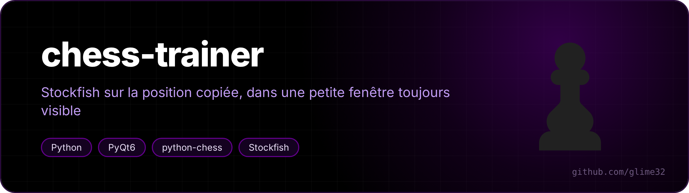
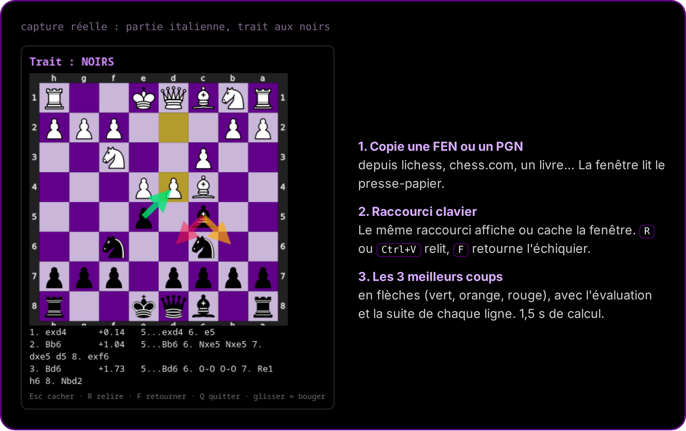

<p align="center"></p>

<p align="center">  </p>

<p align="center"><a href="README.md">🇬🇧 English version</a></p>

**Une petite fenêtre toujours au premier plan qui analyse avec Stockfish la position d'échecs que tu viens de copier (FEN ou PGN) : les 3 meilleurs coups en flèches, avec leur évaluation et la suite.**

Pratique pour revoir tes parties, travailler une ouverture ou vérifier un problème sans quitter la page que tu lis.

<p align="center"></p>

## Utilisation

1. Copie une FEN ou un PGN (sur lichess, chess.com, dans un PDF…).
2. Appuie sur ton raccourci : la fenêtre s'ouvre sur la position. Rappuyer la cache ou l'affiche (la fenêtre déjà lancée est réutilisée grâce à un socket local, pas de deuxième moteur).
3. Touches : **R** ou **Ctrl+V** relit le presse-papier, **F** retourne l'échiquier, **Échap** cache, **Q** quitte. Glisser la fenêtre la déplace (marche sous Wayland).

L'échiquier est vu du côté qui a le trait. Réglages en haut de `trainer.py` : temps de calcul (`THINK`, 1,5 s), nombre de lignes (`LINES`), taille et couleurs de l'échiquier.

## Installation

```bash
sudo pacman -S --needed stockfish python-pyqt6 python-chess   # Arch / CachyOS
git clone https://github.com/glime32/chess-trainer
```

Ensuite, associe `python3 /chemin/vers/chess-trainer/trainer.py` à un raccourci (KDE : *Configuration du système → Raccourcis → Ajouter → Commande*).

> [!IMPORTANT]
> Pour l'analyse et l'entraînement seulement. Utiliser un moteur pendant une partie en cours, c'est de la triche, et les sites d'échecs bannissent les comptes pour ça.
