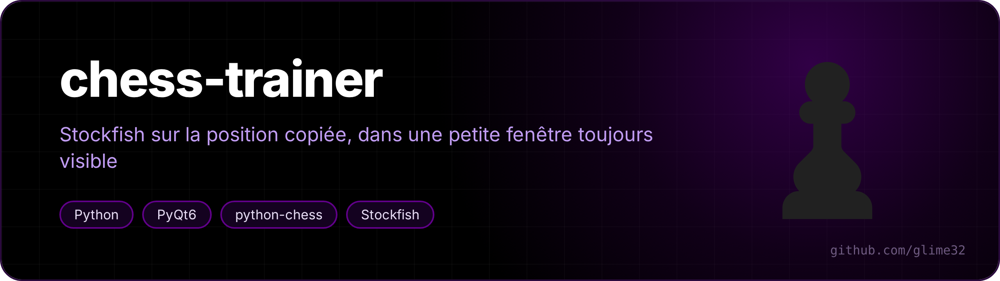
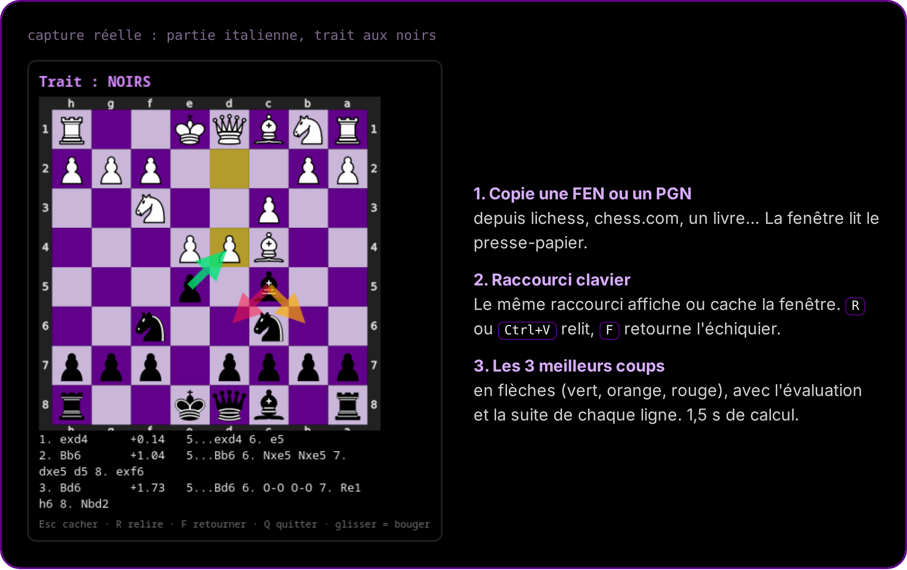

<p align="center"></p>

<p align="center">  </p>

<p align="center"><a href="README.fr.md">🇫🇷 Version française</a></p>

**A small always-on-top window that analyses the chess position you just copied (FEN or PGN) with Stockfish: the 3 best moves as arrows, with their evaluation and line.**

Handy to review your games, study an opening or check a puzzle without leaving the page you're reading.

<p align="center"></p>

## Use

1. Copy a FEN or a PGN (from lichess, chess.com, a PDF…).
2. Press your shortcut: the window opens on the position. Pressing it again hides or shows it (the running instance is reused through a local socket, no second engine).
3. Keys: **R** or **Ctrl+V** re-reads the clipboard, **F** flips the board, **Esc** hides, **Q** quits. Drag the window to move it (works on Wayland).

The board is shown from the side to move. Settings at the top of `trainer.py`: thinking time (`THINK`, 1.5 s), number of lines (`LINES`), board size and colors.

## Install

```bash
sudo pacman -S --needed stockfish python-pyqt6 python-chess   # Arch / CachyOS
git clone https://github.com/glime32/chess-trainer
```

Then bind `python3 /path/to/chess-trainer/trainer.py` to a shortcut (KDE: *System Settings → Shortcuts → Add New → Command*).

> [!IMPORTANT]
> For analysis and training only. Using an engine during a live game is cheating, and chess sites ban accounts for it.
